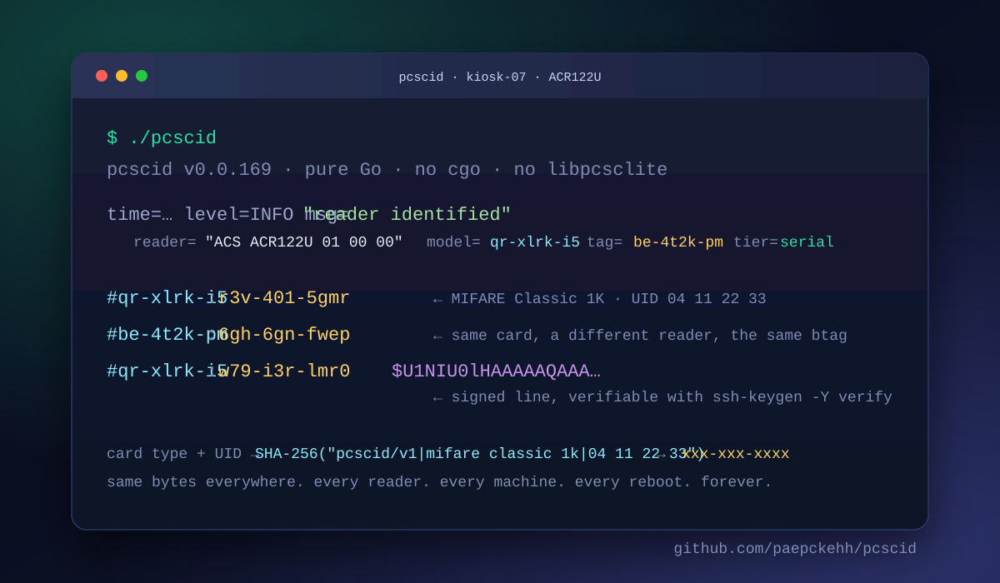
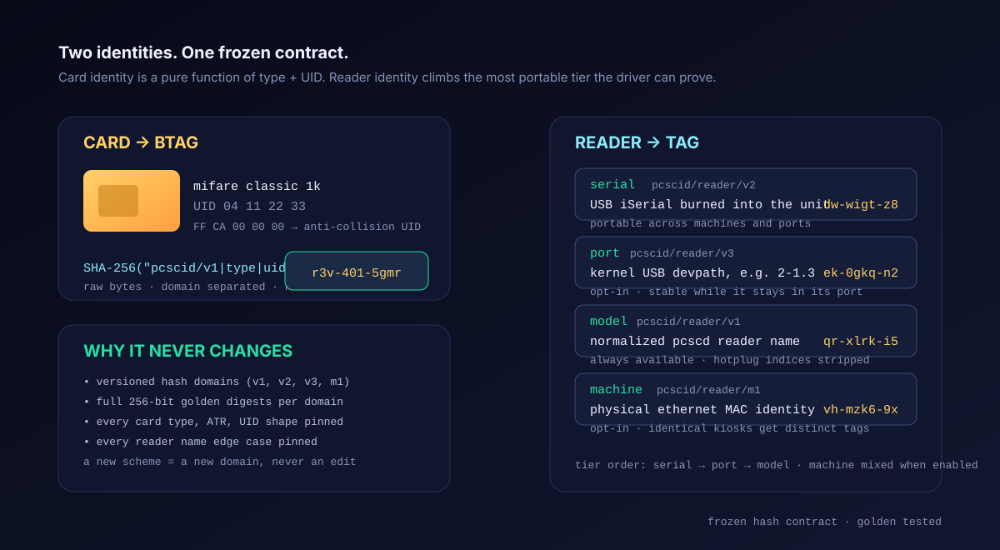
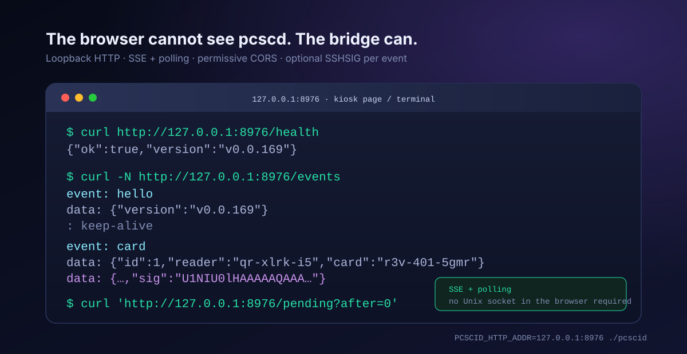

<div align="center">

# pcscid

**Tap a card. Get an identity. The same identity tomorrow, on another reader, on another machine, forever.**

[](#)
[](#)
[](#)
[](#)
[](LICENSE)



Pure Go. No cgo. No `libpcsclite`. No dependencies. One static binary that speaks the
`pcscd` IPC protocol directly and turns every card presentation into a short, stable ID.

</div>

---

## What it does

`pcscid` watches every reader the local `pcscd` manages. When a card arrives it reads the
card's own anti-collision UID, folds it together with the detected card type into a
**btag**, and derives a **reader tag** from the reader's most portable hardware fact.

```console
$ ./pcscid
#qr-xlrk-i5:r3v-401-5gmr
```

That line says: *this specific MIFARE Classic 1K, on this specific ACR122U*. Not "a card was
presented". Not "a MIFARE Classic was presented". The actual card. The actual reader.

## Why it feels like magic

- **Card identity, not type detection.** The ATR only says *a card model* was tapped.
  `pcscid` reads the individual UID through the PC/SC part 3 `GET DATA` pseudo-APDU
  (`FF CA 00 00 00`) and hashes it into `xxx-xxx-xxxx`.
- **Reader identity with tiers.** Hardware serial when the driver serves one, physical USB
  port path when it does not, model tag as the always-available fallback. Optional machine
  MAC scoping for fleets of identical kiosks.
- **No btag without a real UID.** A failed UID read or an ISO/IEC 14443-3 random UID
  (phone NFC emulation, eID, newer DESFire) is rejected. No ATR-derived type-level btag
  is ever invented.
- **Hardware-free test suite.** An independent in-process fake `pcscd` speaks the whole
  wire protocol. Client and fake disagreeing is itself a test failure.
- **Hash stability is a contract.** Every domain, every card type, every reader name edge
  case and the full 256-bit digest of each domain is pinned by golden tests. A future
  refactor cannot silently change a stored identifier.

## Try it in 30 seconds

```console
$ git clone https://github.com/paepckehh/pcscid
$ cd pcscid
$ make build
$ ./pcscid
```

Requires a running `pcscd` and a reader it knows about. On a kiosk with an ACR122U:

```console
$ PCSCID_USB_PATH_ID=1 PCSCID_MAC_ID=1 ./pcscid
#qr-xlrk-i5:r3v-401-5gmr
#be-4t2k-pm:6gh-6gn-fwep
```

stdout is machine-readable by design: one `#<reader-tag>:<btag>` line per presentation,
nothing else. The startup inventory, settings and diagnostics go to stderr.

## Two identities, one frozen contract

<div align="center">

</div>

### Card: the btag

```text
btag = alnum( SHA-256("pcscid/v1|" + card-type + "|" + uid) )[:10]
       -> xxx-xxx-xxxx, digits and lowercase only
```

Pure function of card type and raw UID bytes. No timestamps, no reader names, no machine
state. The same card produces the same btag everywhere.

### Reader: model, unit, machine

| Tier | Input | Domain | Stable across | Switch |
| --- | --- | --- | --- | --- |
| Model | normalized pcscd reader name | `pcscid/reader/v1` | everything | always |
| Unit: serial | USB iSerial (`SCARD_ATTR_VENDOR_IFD_SERIAL_NO`) | `pcscid/reader/v2` | machines, ports, restarts | automatic |
| Unit: USB port | kernel USB devpath (`SCARD_ATTR_CHANNEL_ID` → sysfs) | `pcscid/reader/v3` | reboots while in the same port | `PCSCID_USB_PATH_ID=1` |
| Machine scope | physical ethernet MAC identity | `pcscid/reader/m1` | within one machine | `PCSCID_MAC_ID=1` |

Serial-less readers (the ACR122U family serves the same all-zero iSerial on every unit) are
told apart by their **USB traffic**: the probe window's URB burst moves exactly one
candidate's sysfs `urbnum` counter. No guessing, no daemon reader order dependence.

### The forever contract

These are frozen and golden-tested, not implementation details:

- domain strings and separators: `pcscid/v1`, `pcscid/reader/v1`, `v2`, `v3`, `m1`
- raw UID bytes, SHA-256, the `0-9a-z` alphabet, modulo-36 mapping and dash layout
- every card type string returned by detection
- every `normalizeReaderName` hotplug-index edge case
- the full 256-bit digest per domain, not only the visible truncation

A new scheme gets a **new versioned domain** and a new function. Existing tags keep their
existing bytes. New card types, ATRs and reader name shapes must add a golden row in
[`hash_test.go`](hash_test.go). Golden values are never regenerated. See
[AGENTS.md](AGENTS.md#hash-stability-contract-frozen-api) for the complete contract and
test list.

## Under the hood

```text
cmd/pcscid ─ pcscid ─ pcsc ─ /run/pcscd/pcscd.comm ─ pcscd
                              │
                              ├─ frames, codecs, version down-negotiation
                              ├─ READER_STATE polling + change waits
                              └─ connect / transmit / get-attrib / disconnect
```

The `pcsc` package implements the daemon wire protocol from scratch: framed requests,
header-less raw struct responses, protocol 4.4+ wait registration with client-side timeout
and stop, old 4.2/4.3 wait bodies, and the one unframed `CMD_TRANSMIT` exchange.

Identity layers:

- `uid.go` insists on the card UID across activation races and wedged PICC states, with a
  card reset and a generous reopen budget for the ACR122U anti-collision rerun.
- `readerid.go` resolves serial, channel id, sysfs port paths, CCID device matching, URB
  correlation and the session unit registry.
- `readers.go` produces the startup inventory with exactly the tags the event stream will
  carry.
- `sign.go` parses OpenSSH ed25519 keys and emits SSHSIG signatures compatible with
  `ssh-keygen -Y verify`.

## Bridge mode: for browser kiosks

<div align="center">

</div>

A browser cannot open the `pcscd` Unix socket. Set `PCSCID_HTTP_ADDR` and the same binary
serves reader tags and btags over loopback HTTP with permissive CORS:

| Endpoint | Answer |
| --- | --- |
| `GET /health` | `{"ok":true,"version":"v0.0.170"}` |
| `GET /events` | SSE: `hello`, then one `card` event per scan, 20 s keep-alive |
| `GET /pending?after=N` | JSON replay by monotonic cursor, ring keeps 64 |

```console
$ PCSCID_HTTP_ADDR=127.0.0.1:8976 ./pcscid
$ curl http://127.0.0.1:8976/health
{"ok":true,"version":"v0.0.170"}
```

The listen address must be loopback unless `PCSCID_HTTP_ALLOW_REMOTE=1` lifts the guard.
Card identities should never leave the kiosk by accident.

## Signed output lines

Set `PCSCID_SIGN_KEY` to a passphrase-less `ssh-ed25519` private key. Every stdout line and
every bridge event is extended with the base64 SSHSIG signature of the exact line
`#<reader-tag>:<btag>`, verifiable with the stock OpenSSH tool:

```console
$ PCSCID_SIGN_KEY=/etc/pcscid/id_ed25519 ./pcscid
#qr-xlrk-i5:r3v-401-5gmr$U1NIU0lHAAAAAQAAA…
```

Namespace is `pcscid`. A configured but unusable key fails the startup instead of silently
producing unsigned output.

## Library

```go
opts := &pcscid.Options{
    USBPathID: true,
    MACID:     true,
    Logger:    logger,
}
events, err := pcscid.Watch(ctx, opts)
if err != nil {
    return err
}
for ev := range events {
    if ev.Kind == pcscid.KindInsert {
        fmt.Printf("#%s:%s\n", ev.ReaderTag, ev.Card.ID)
    }
}
```

Also exported: `Btag`, `ReaderTag`, `ReaderTagWithSerial`, `ReaderTagWithUnit`,
`ReaderTagWithMachine`, `DetectType`, `ParseATR`, `IdentifyReaders`, `MachineID`,
`NewBridge`, `RequireLoopback`, `NewSigner`.

## Configuration

| Variable | Effect |
| --- | --- |
| `DEBUG=1` | Full protocol and identity trace on stderr, stdout stays clean |
| `PCSCID_USB_PATH_ID=1` | Anchor serial-less readers to their physical USB port |
| `PCSCID_MAC_ID=1` | Mix the machine MAC identity into every reader tag |
| `PCSCID_HTTP_ADDR` | Enable the loopback HTTP bridge on this address |
| `PCSCID_HTTP_ALLOW_REMOTE=1` | Allow a non-loopback bridge listen address |
| `PCSCID_SIGN_KEY` | Sign every output line and bridge event with an SSH ed25519 key |
| `PCSCLITE_CSOCK_NAME` | Override the `pcscd` socket path |

## Build, test, release

```console
$ make build     # static binary with the git tag as semver
$ make test      # parallel, no hardware, no test cache
$ make check     # gofmt, go vet, go mod tidy diff
```

Release artifacts are cross-compiled for linux, freebsd, openbsd and netbsd on amd64 and
arm64, plus deb/rpm packages and SHA-256 checksums. The runtime is Linux-only; the pure Go
binary itself compiles everywhere.

## Security and privacy

- The btag is a truncated SHA-256 identifier, not a secret. Treat it like a username,
  never like a password or a key.
- No card data leaves the machine unless you enable the bridge, and even then the default
  listen guard is loopback-only.
- Random/rotating UIDs are rejected by design: privacy-preserving cards get no btag and no
  output line.
- SSHSIG signatures cover the exact output bytes, so downstream consumers can enforce
  signed punches from the kiosk.

---

<div align="center">

**Docs:** [AGENTS.md](AGENTS.md) · [LICENSE](LICENSE) · [Issues](https://github.com/paepckehh/pcscid/issues)

*NFC · MIFARE · RFID · ISO 14443 · eID · YubiKey · contact cards — if pcscd sees it, pcscid identifies it.*

</div>
