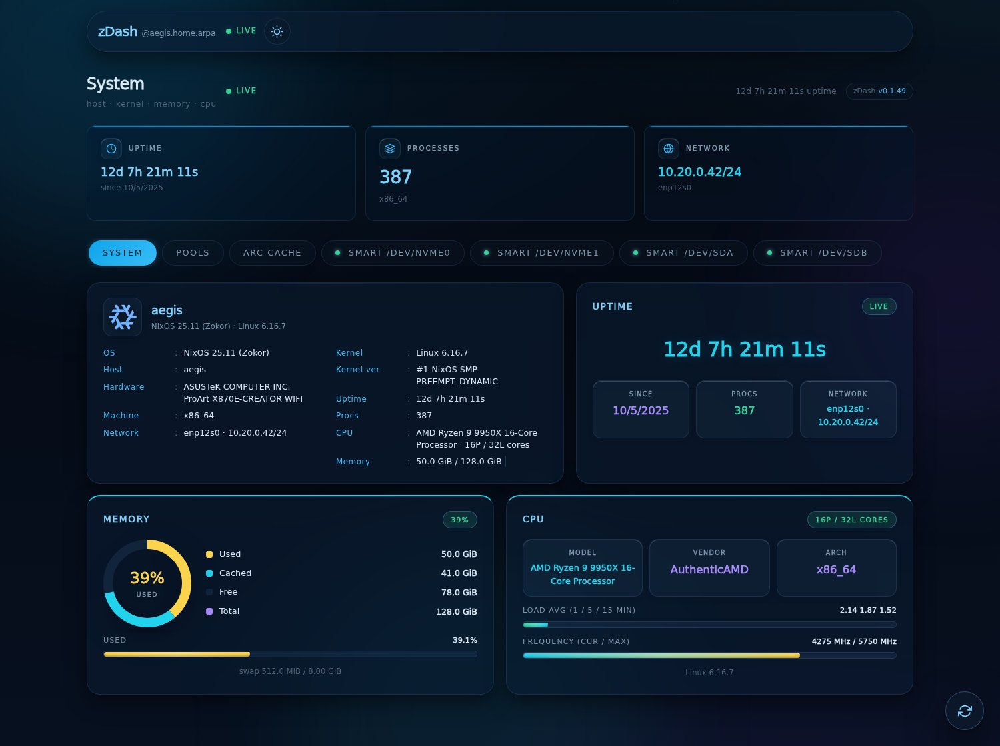
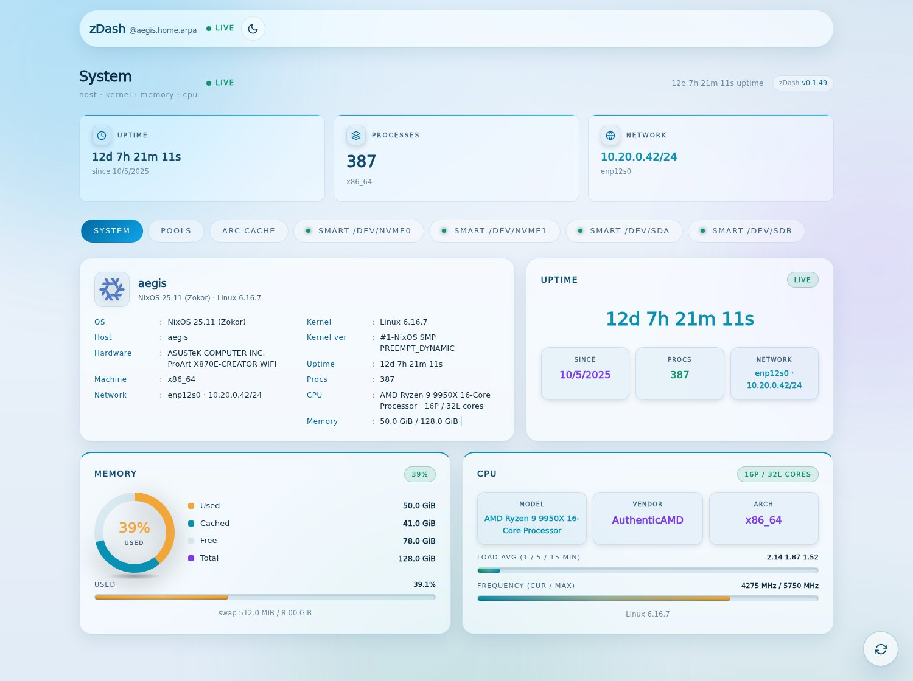
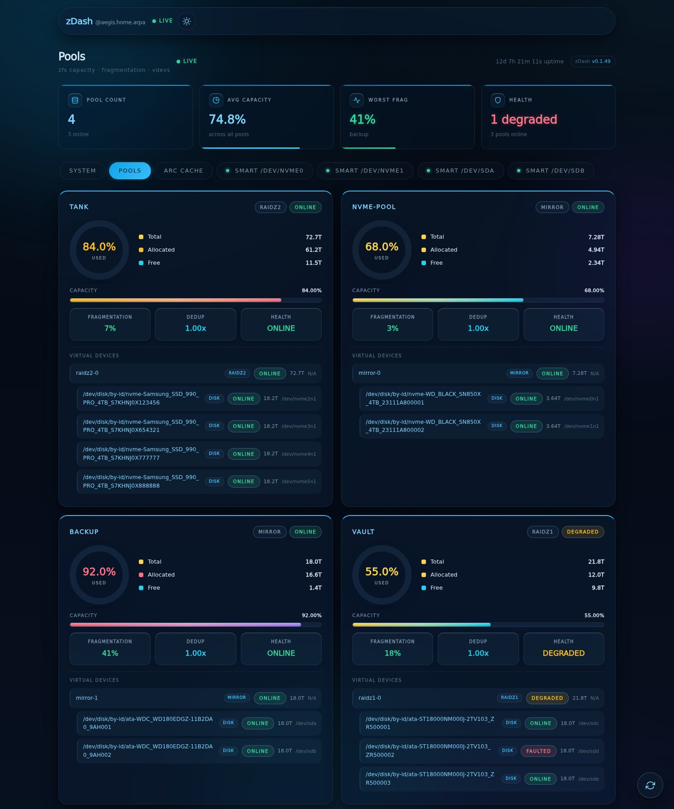
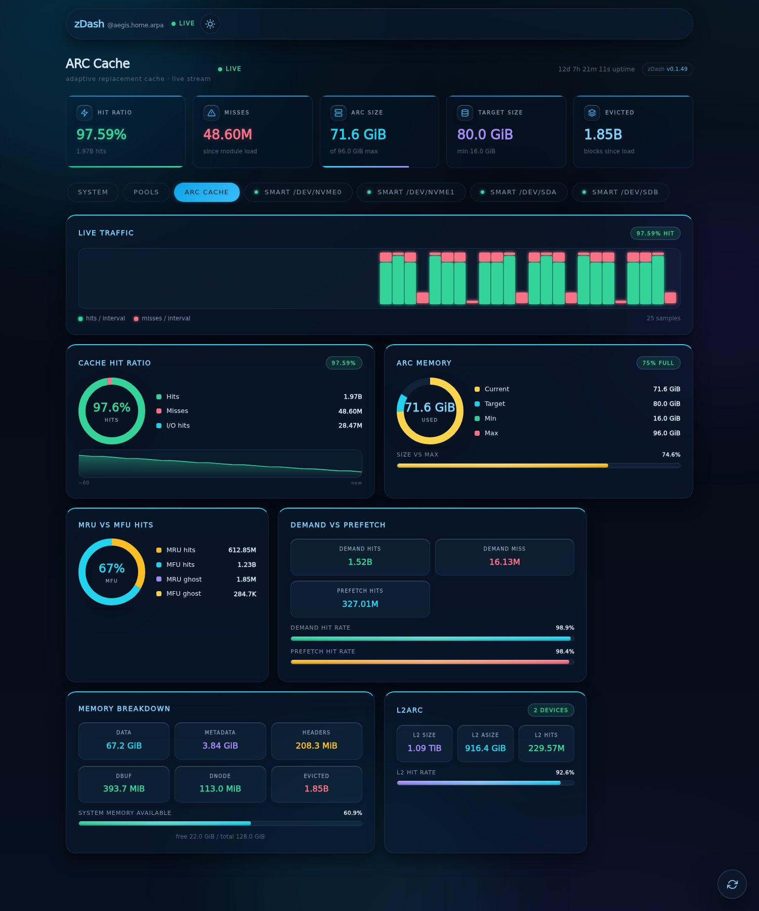
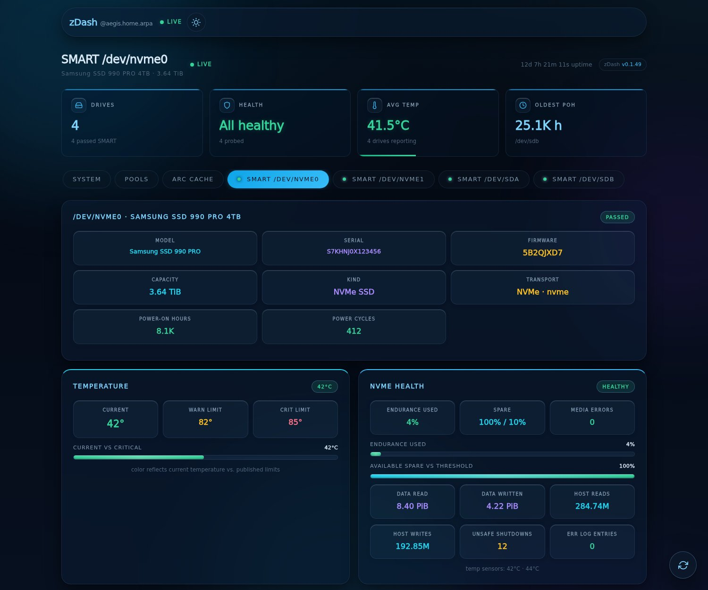
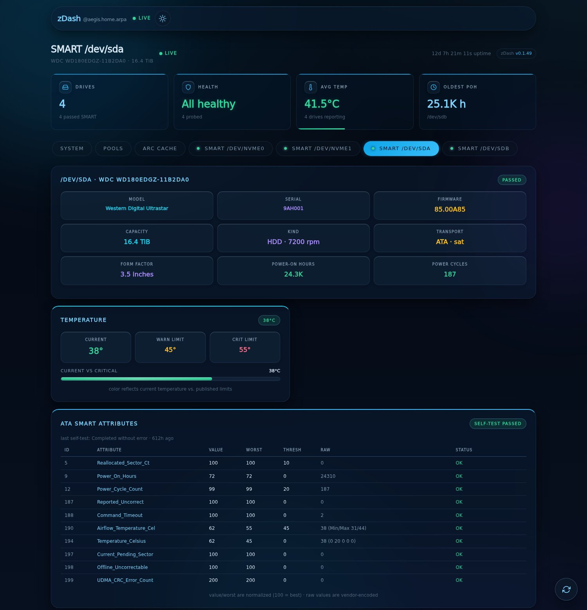
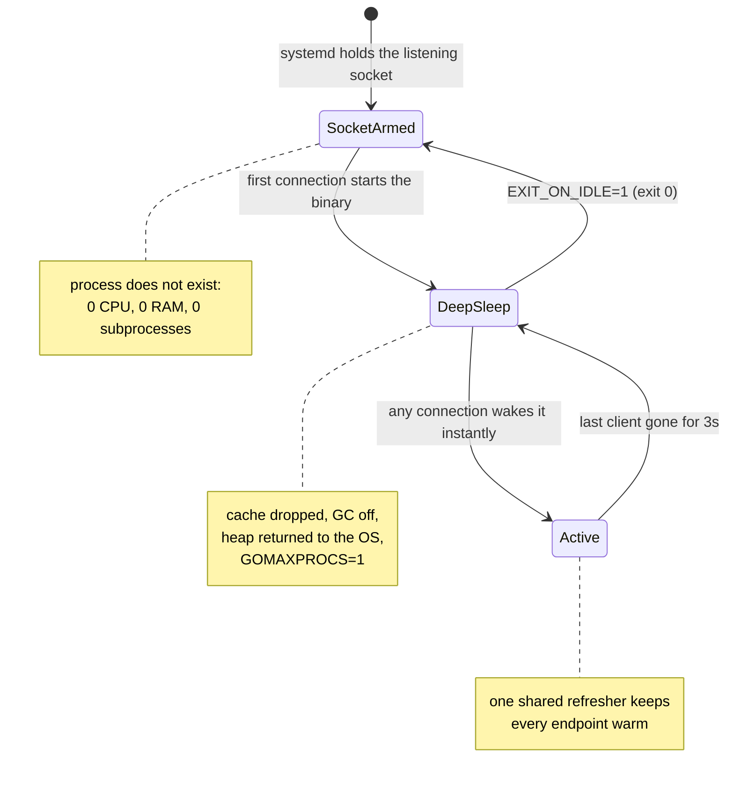
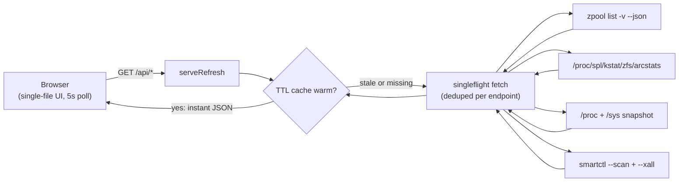

<div align="center">

# ⚡ zDash

**A general system dashboard with a ZFS superpower, and it costs nothing while you look away.**

OS, kernel, CPU, memory, network and drives on any host, plus deep ZFS insight: pool health, recursive vdev topology, per-drive SMART, and ARC cache analytics that show **how well your ZFS is actually working**. Deployed as a socket-activated systemd service, zDash is **gone when nobody is watching** and **under 10 MB** when you are.

<p>
  <a href="https://github.com/paepckehh/zdash/actions/workflows/golang.yml"></a>
  <a href="https://github.com/paepckehh/zdash/releases"></a>
  <a href="LICENSE"></a>
</p>
<p>
  
  
  
  
  
</p>

<p>
  <a href="#-why-zdash"><b>Why zDash?</b></a> ·
  <a href="#-screenshots"><b>Screenshots</b></a> ·
  <a href="#-quick-start"><b>Quick Start</b></a> ·
  <a href="#-the-zero-cost-contract"><b>Zero-Cost Contract</b></a> ·
  <a href="#-api"><b>API</b></a> ·
  <a href="#-architecture"><b>Architecture</b></a> ·
  <a href="#-deployment-nixos--systemd"><b>Deployment</b></a> ·
  <a href="#-faq"><b>FAQ</b></a>
</p>

</div>

---

## 🎯 Why zDash?

**1. 🖥️ A real system dashboard.** OS and codename, kernel, SMBIOS vendor/product/version, CPU model, cores and clocks, memory and swap, load averages, uptime, FQDN, locale, default-route interface and IPv4, process count. A fastfetch-style host overview that is always one tab away, on any Linux host. FreeBSD and macOS hosts get the pool and SMART views too.

**2. 💾 ZFS-aware, not just ZFS-adjacent.** Most dashboards show you a filesystem. zDash shows you *how well it is working*:

- **Pools:** health, capacity, fragmentation, dedup, and the full recursive vdev/disk topology, straight from `zpool list -v --json`.
- **Drives:** per-drive SMART tabs with temperature, wear, power-on hours, NVMe endurance and a full ATA attribute table, probed in parallel with one timeout budget per device.
- **ARC cache:** the thing that actually decides your storage performance. Hit ratio, live hit/miss traffic stream, window-scaled history sparkline, MRU/MFU split, demand vs prefetch, L2ARC stats, read from the ZFS kstat directly.

**3. 😴 Resource-aware, almost aggressively so.** zDash is the dashboard you can install on *every machine you own* without a second thought:

- **Socket-activated by systemd:** the binary only exists while someone is looking. No connection, no process.
- **Zero passive cost:** no polling daemon, no cron scrape, no resident agent. 0 CPU, 0 RAM, 0 subprocesses while idle.
- **Under 10 MB while you watch:** measured 9.3 MB RSS under active traffic, with the shipped NixOS modules pinning `GOMEMLIMIT=8MiB`.
- **One fetcher for every tab:** a single background refresher keeps the API warm, and every open dashboard shares it.
- **Featherweight client:** one self-contained page, no framework, no build step, no `node_modules`, no external assets.

> **The elevator pitch:** it is a fastfetch-style system panel, a ZFS pool/X-ray, and an ARC cache monitor in one binary that has no dependencies and disappears when you close the tab.

---

## 📸 Screenshots

<p align="center">
  
</p>

| ☀️ Light mode | 💾 Pools and vdev topology |
|:---:|:---:|
|  |  |

| 🔥 ARC cache analytics | 🧠 SMART and NVMe health |
|:---:|:---:|
|  |  |

<p align="center">
  
  <br>
  <em>Per-drive ATA attributes, threshold checks, and self-test results. Every tab is live, every value updates in place.</em>
</p>

Screenshots are captured from the real embedded dashboard using canned fixtures, so no production hostnames or serial numbers were harmed.

---

## ✨ What is in the box?

| Area | What you get |
|---|---|
| **Host** | Distro brand mark, OS/codename/build ID, kernel release and build, SMBIOS vendor/product/version/family, machine arch, FQDN, CPU model/vendor/physical vs logical cores/clocks, memory + swap + cache, load averages, uptime, process count, locale, default-route interface and IPv4 |
| **Pools** | State, capacity, fragmentation, dedup ratio, health, recursive vdev tree with per-disk state and paths, total/allocated/free per pool |
| **SMART** | Per-drive tabs, model/serial/firmware/capacity/form factor/transport, temperature with warn/crit limits, power-on hours and cycles, NVMe endurance/spare/media errors/unsafe shutdowns, ATA attributes with threshold and raw-value highlighting, last self-test result |
| **ARC** | Hit ratio, hits/misses since module load, live traffic stream, hit-ratio sparkline, ARC size vs target vs max, MRU/MFU and ghost hits, demand vs prefetch hit rates, data/metadata/header/dbuf/dnode breakdown, eviction count, L2ARC size/hit rate/device count |
| **UI** | Light and dark themes, glassmorphic cards, animated donut gauges and bars, 3D KPI tiles, tabbed navigation, per-drive tabs, live/offline pill, manual refresh button, responsive layout, reduced-motion support |
| **Ops** | Zero-dependency static binary, embedded assets, session-scoped TTL cache, singleflight fetches, 4-minute session ceiling, capability-driven tab hiding, subpath/reverse-proxy-safe URLs, structured JSON APIs |

### 🆕 The latest bits

- **Live ARC traffic stream:** hits and misses per poll rendered as a rolling 48-column histogram, with a smoothed scale so one busy interval does not flatten the rest.
- **Window-scaled sparkline:** the hit-ratio history now scales to the observed window instead of a fixed 0-100, so small movements are visible.
- **Five-slot KPI strip:** the numbers that matter for the active tab, mounted once and updated in place, with per-tab accents and progress bars.
- **Per-drive SMART tabs:** NVMe and ATA get purpose-built views, including an attribute table that highlights reallocated sectors, pending sectors, and failed self-tests.
- **Capability-aware navigation:** no ZFS kernel? Pools and ARC tabs disappear. No `smartctl`? SMART tabs disappear. No error banners, no dead tabs.
- **Dark-mode matrix rain:** a subtle, throttled, reduced-motion-aware canvas ambient. It does not fire in light mode and it does not run at 60 fps for a 0.05-opacity effect.
- **Proxy-safe polling:** all API URLs resolve relative to `document.baseURI`, so a reverse proxy or subpath deployment works without rewriting JavaScript.
- **Session ceiling:** a continuously connected client is force-closed after 4 minutes so the process can park or exit; the client reconnects on its next poll, and an active endpoint gets a fresh capped window.
- **FQDN and SMBIOS identity:** the header shows `host.domain`, not just the short hostname.

---

## 🚀 Quick Start

> **Prerequisites:** Go 1.27+ and a working `zpool` binary on a ZFS host (Linux, FreeBSD, macOS). No CGO, no Node, no build step.

**Try it right now**, no clone and no install:

```bash
go run paepcke.de/zdash/cmd/zdash@latest
xdg-open http://localhost:8080
```

**Install it permanently:**

```bash
go install paepcke.de/zdash/cmd/zdash@latest
```

**Or grab a prebuilt static binary** from the [Releases](https://github.com/paepckehh/zdash/releases) page: `.deb`, `.rpm`, and tarballs for linux/freebsd/darwin on amd64/arm64, all `CGO_ENABLED=0` and statically linked.

**NixOS, the one-liner version:**

```nix
imports = [ ./zdash/systemd-socket.nix ];
```

The first request starts the service. The last closed session stops it. That is the whole deployment story.

---

## 😴 The Zero-Cost Contract

zDash was designed around one question: *what should a dashboard cost when nobody is looking?* The answer: **nothing**. Not "a little", not "one idle thread", nothing. With the socket-activated deployment the process literally does not exist between visits.



### Measured, not promised

| State | CPU | RAM | `zpool` / `smartctl` runs |
|---|---|---|---|
| Nobody looking (socket-activated module) | **0**, the process does not exist | **0 MB** | **0** |
| Nobody looking (plain module, deep sleep) | ~0 (one parked thread) | ~7 MB boot, ~9 MB parked | **0** |
| You are looking | a few ms per refresh cycle | **9.3 MB** (measured, `GOMEMLIMIT=8MiB`) | 1 `zpool` / ~5 s, 1 `smartctl` sweep / 60 s |

All open tabs share one TTL cache, so ten dashboards watching one host still cost one `zpool` run every ~5 seconds. The moment the last tab closes, the refresher stops, the cache is dropped before `FreeOSMemory`, the GC switches off, the heap is handed back to the OS, and all but one OS thread park. A late fetch cannot smuggle stale bytes into the next session: every cache store is guarded by the session generation it started under.

A continuously connected client is capped at **4 minutes**. When the cap fires, every live connection is force-closed so the process can park (or exit under `EXIT_ON_IDLE` and let socket activation re-arm). The client reconnects on its next poll and gets a fresh capped window. A forgetful proxy or a pinned keep-alive socket can never hold the process awake forever.

<details>
<summary><b>🛠️ What "deep sleep" actually does under the hood</b></summary>

- The refresher stops, its stop channel closes, and the entry map is cleared first, so the pages are actually free for the OS.
- `debug.SetGCPercent(-1)` switches the GC off, and `debug.FreeOSMemory()` returns the heap to the OS.
- `runtime.GOMAXPROCS(1)` parks all but one OS thread.
- Only the listener epoll stays armed. The first new connection wakes the process instantly, restoring `GOMAXPROCS` and the GC (`GOGC`-tunable).
- With `EXIT_ON_IDLE=1` the process exits (status 0) at the sleep transition. Pair it with a systemd `.socket` unit and idle RAM/CPU are *exactly* zero; systemd restarts the binary on the next connection.

</details>

### 🪶 Featherweight on the client, too

- One self-contained HTML payload per browser, then cached. The entire UI is a single file: no framework, no build step, no `node_modules`, no external asset requests.
- After that, four small JSON responses every 5 seconds (a few KB total), with `Cache-Control: no-store` so a stale tab cannot pin old bytes.
- The UI is mount-once/update-in-place for cards, KPI tiles, donuts, bars, and sparklines. CSS transitions do the animating, not DOM churn.
- A hidden tab pauses polling. The server's 30-second idle timeout drops the dormant keep-alive socket, the process deep-sleeps, and the tab's next poll on becoming visible reconnects instantly.
- `prefers-reduced-motion` disables the matrix rain and all decorative transitions.

---

## 🔌 API

All endpoints are `GET`-only and return `application/json` (except `/`, which serves the embedded dashboard). Every response is pre-encoded by the session-scoped refresher, so handlers do nothing but copy cached bytes.

| Method | Path | Description |
|---|---|---|
| `GET` | `/` | Embedded single-file dashboard (`text/html`) |
| `GET` | `/api/zpool` | Pool health, capacity, fragmentation, recursive vdev/disk topology, typed `zpool list -v --json` |
| `GET` | `/api/arc` | ARC hit ratio, sizes, MRU/MFU, demand vs prefetch, L2ARC, from the ZFS kstat |
| `GET` | `/api/sysinfo` | Host snapshot: OS, kernel, SMBIOS, CPU, memory, load, network, from `/proc` + `/sys` |
| `GET` | `/api/smart` | Per-drive SMART health: temperatures, wear, power-on hours, ATA/NVMe attributes, from `smartctl` |

```bash
curl -s http://localhost:8080/api/zpool   | jq '.pools | keys'
curl -s http://localhost:8080/api/arc     | jq '{hits, misses, size, c_max}'
curl -s http://localhost:8080/api/smart   | jq '.devices[] | {name, ok, temp: .details.temperature_current}'
curl -s http://localhost:8080/api/sysinfo | jq '{hostname, fqdn, os, cpu_model, memory_total_bytes}'
```

> Tabs for capabilities the host lacks are hidden automatically. `/api/smart` reports `smartctl_available`, and `/api/sysinfo` reports `zfs_available` + `arc_available`. The endpoint still answers `200` so the dashboard can hide the tab instead of showing an error state.

---

## 🏗️ Architecture



1. **Startup:** `cmd/zdash/main.go` builds an `http.Server` with explicit read/write/idle timeouts, registers Go 1.22 method-aware routes (non-GET gets an automatic 405), wires the `ConnState` session hook, parks the runtime, and enters deep sleep. Nothing is scraped at boot: no `zpool`, no `smartctl`, no `/proc` read.
2. **Session:** the first connection wakes the runtime and starts the refresher. A 5-second loop keeps every endpoint warm on its TTL schedule (zpool/arc/sysinfo 6 s, SMART 60 s). The last closed connection stops the loop and drops the cache.
3. **Requests:** handlers answer from the warmed cache. Concurrent refreshes of one endpoint dedupe into a single fetch. Fetches survive disconnecting clients (`context.WithoutCancel`); waiters whose client dies fall back to the newest stale snapshot or a 503 JSON error.
4. **Rendering:** the dashboard probes `/api/sysinfo` first for capabilities, then fetches pools, ARC, and SMART in parallel. Cards mount once under stable keys; each poll mutates text, widths, attributes, and classes in place. The nav pill flips to a red *offline* state if any enabled endpoint fails.
5. **Degradation:** failed subprocesses, unparseable files, and missing `/proc`/`/sys` entries degrade to empty fields or JSON error bodies. The server never crashes because a drive went to sleep.

<details>
<summary><b>🔍 Implementation notes (the fun parts)</b></summary>

- **Zero-dependency singleflight and TTL cache:** hand-rolled in a few hundred lines instead of importing `golang.org/x/sync`; `go.mod` has zero requires.
- **Deterministic parallel SMART:** one goroutine per discovered device, results land in the device's scan slot, so the report order is stable without a lock.
- **Embedded everything:** the whole UI, including inline single-path brand SVGs from simpleicons.org, ships inside the binary via `embed.FS`, rendered once and cached with `sync.OnceValue`.
- **NixOS resolver seam:** `zpool` and `smartctl` are resolved via a `stat` check for `/run/current-system/sw/bin/...` because NixOS does not put them on the default `$PATH`.
- **Session generation guard:** a fetch that started in a dead session can finish, but it cannot repopulate the next session's cache.
- **Capability-aware tabs:** the host tells the UI what it can do; the UI hides what it cannot.
- **No external fonts:** the page uses a system font stack, so it works air-gapped and does not phone home to a font CDN.

</details>

---

## ⚙️ Configuration

| Environment Variable | Default | Description |
|---|---|---|---|
| `BIND_ADDR` | `127.0.0.1:8080` | Fallback listen address (used only when no systemd fd is adopted) |
| `SOCKET_ACTIVATION` | `0` | Set `1` to adopt the fd systemd passes via `LISTEN_FDS` (Linux only, opt-in; a stray `LISTEN_FDS` can never hijack fd 3) |
| `EXIT_ON_IDLE` | `0` | Set `1` to `exit(0)` once the last session closes (pair with a systemd `.socket` unit) |

The standard Go runtime knobs work too. The shipped NixOS modules set `GOMEMLIMIT=8MiB` to pin the active footprint under 10 MB, and the wake path honors `GOGC` for the GC target percentage.

```bash
./zdash                                              # defaults: localhost only
BIND_ADDR=0.0.0.0:9090 ./zdash                        # custom port, all interfaces (front it with auth!)
GOMEMLIMIT=8MiB ./zdash                               # keep RSS under 10 MB anywhere
BIND_ADDR=127.0.0.1:8080 go run -race ./cmd/zdash     # with the race detector
```

> ⚠️ **`BIND_ADDR=0.0.0.0:...` exposes the dashboard to your network with no authentication.** Always front it with a reverse proxy (Caddy, Nginx, Traefik) that adds auth before binding to a non-loopback address.

---

## 🖥️ Deployment: NixOS + systemd

The repo ships **two alternative, identically hardened NixOS modules**. Both are self-contained, bind `127.0.0.1:9091`, pin `GOMEMLIMIT=8MiB`, and are fronted by a Caddy vhost `http://zdash` that reverse-proxies to the loopback service. Import exactly **one** of them.

```nix
# configuration.nix
imports = [ ./zdash/systemd.nix ];          # starts at boot, deep-sleeps between sessions
# imports = [ ./zdash/systemd-socket.nix ]; # socket-activated: zero idle cost, exits when idle
```

- **`systemd.nix` (plain):** wanted by `multi-user.target`, binds `127.0.0.1:9091` itself, deep-sleeps between sessions. Idle CPU is near zero.
- **`systemd-socket.nix` (socket-activated):** `systemd.sockets.zdash` (wanted by `sockets.target`) holds the socket; the service is not started at boot at all. The first dashboard connection activates it, the binary adopts the passed fd (`SOCKET_ACTIVATION=1`), and it exits (status 0) once the last session closes (`EXIT_ON_IDLE=1`). `StartLimitIntervalSec = 0` keeps the on-demand restarts from ever being rate-limited. Idle RAM and CPU are exactly zero.

<details>
<summary><b>🛡️ Unit hardening highlights</b></summary>

- `ProtectSystem=strict`, `ProtectHome`, `PrivateTmp`, `NoNewPrivileges`, `LockPersonality`, `MemoryDenyWriteExecute`, `RestrictNamespaces`
- `SystemCallFilter=@system-service`, `RestrictAddressFamilies` limited to inet/inet6/unix
- `SocketBindDeny=any` with only `SocketBindAllow=tcp:9091`, `IPAddressDeny=any` with loopback allowed (the Caddy reverse proxy lives on the same host)
- Resource caps: `MemoryMax=128M`, `TasksMax=32` (main process plus parallel smartctl children), and `Nice=10` / `CPUWeight=10` / `IOWeight=10`. A dashboard must never compete with the storage stack it monitors.
- Deliberately **not** restricted: capability bounding set, `@privileged`/`@resources` syscall groups, `PrivateDevices`, `ProcSubset`, because `zpool` and `smartctl` need raw disks, `/dev/zfs`, and `/proc/spl` kstats.

</details>

---

## 🛠️ Build from Source

```bash
git clone https://github.com/paepckehh/zdash.git
cd zdash

# the easy way (wraps go build + version ldflags)
make build

# ...or build directly
go build -C cmd/zdash -o zdash \
  -ldflags="-X main.version=$(git describe --tags --abbrev=0 2>/dev/null || echo 'dev')"

./zdash
```

**Reproduce the full release pipeline locally.** [goreleaser](https://goreleaser.com) v2 cross-compiles every supported target (linux/freebsd/darwin x amd64/arm64, all `CGO_ENABLED=0`, `-trimpath -s -w`, version stamped into the binary and the dashboard), packs wrapped tarballs plus `.deb`/`.rpm` packages with docs, and writes `checksums.txt`:

```bash
make release-snapshot   # full dry run: test, build, package, checksums, publishes nothing
make release-check      # validate .goreleaser.yml only
```

Releases are cut automatically by the [Release workflow](https://github.com/paepckehh/zdash/actions/workflows/release.yml) whenever a `v*` tag is pushed.

---

## ❓ FAQ

<details>
<summary><b>The Pools tab shows a 500 error</b></summary>

The process needs read access to `/dev/zfs` (typically root, or membership in the `zfs`/`disk` group). The error body includes a permissions hint.
</details>

<details>
<summary><b>No SMART tabs</b></summary>

`smartctl` is missing or not permitted for this user. Check `smartctl_available` in `/api/smart`. The endpoint still returns `200` so the UI can hide the tabs gracefully.
</details>

<details>
<summary><b>Running on a host without ZFS</b></summary>

The server responds `200` everywhere; the dashboard hides the Pools/ARC tabs and keeps showing the system overview.
</details>

<details>
<summary><b>Why does my hidden browser tab re-wake the server?</b></summary>

The server drops dormant keep-alive sockets after its 30 s idle timeout and deep-sleeps. The tab's next poll on becoming visible reconnects instantly and wakes it. That is the design, not a bug.
</details>

<details>
<summary><b>Why does a session end after 4 minutes?</b></summary>

A hard ceiling keeps a pinned keep-alive socket or a forgetful proxy from holding the process awake forever. The client reconnects on its next poll and gets a fresh window; an actively polling endpoint is never left unserved.
</details>

<details>
<summary><b>Windows?</b></summary>

The library compiles, but there is no `zpool` on Windows. Treat it as a build-matrix curiosity, not a target.
</details>

---

## 🗺️ Roadmap

Ideas, not promises:

- Prometheus `/metrics` endpoint
- Persistent history across restarts (long-horizon sparklines)
- Pool health-change notifications
- Multi-host aggregation view
- Historical SMART trend charts

---

## ⭐ Star History

<details>
<summary>Show the chart</summary>

[](https://star-history.com/#paepckehh/zdash&Date)

</details>

---

## 🤝 Contributing

Contributions are welcome. Please:

1. Fork the repo and create a feature branch.
2. Run `make check` (gofmt + vet) before pushing.
3. Add or update tests in the matching `*_test.go` file using the canned fixtures in `testdata/`.
4. Open a pull request with a clear description of **what** and **why**.

> 🤖 **AI policy:** Go code in this repo is human-made and human-reviewed. HTML, the README, and parsers are AI-assisted and labelled as such. Keep Go changes minimal and idiomatic.

---

## 🙏 Acknowledgements

- Distro and host logos: single-path SVGs from [simpleicons.org](https://simpleicons.org), embedded inline so the dashboard stays fully offline-capable (Tux is the fallback).
- ZFS, OpenZFS, and the `zpool --json` / kstat authors, for making all of this data so pleasant to consume.

## 📄 License

Distributed under the **MIT License**. See [`LICENSE`](LICENSE) for details.

---

<div align="center">

**Built with idiomatic Go, embedded assets, and modern web standards. No frameworks, no build step, no node_modules, no excuses.**

[Why zDash?](#-why-zdash) · [Screenshots](#-screenshots) · [Quick Start](#-quick-start) · [Zero-Cost Contract](#-the-zero-cost-contract) · [API](#-api) · [Architecture](#-architecture) · [Deployment](#-deployment-nixos--systemd) · [Contributing](#-contributing)

</div>
