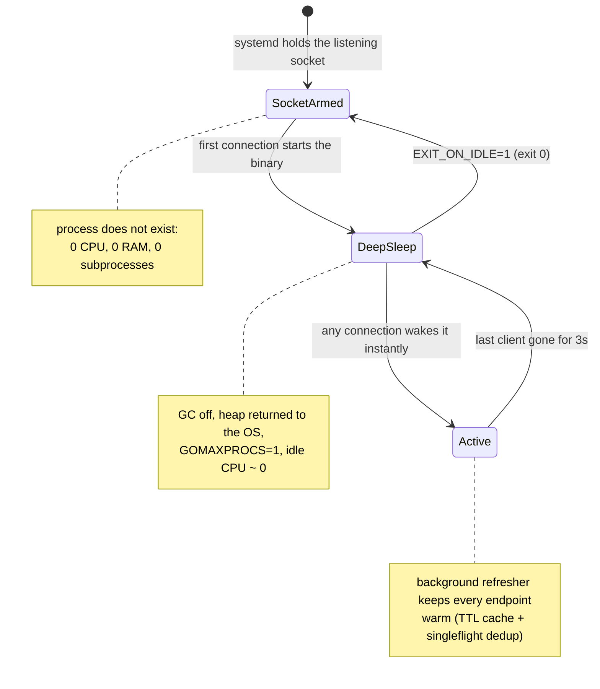
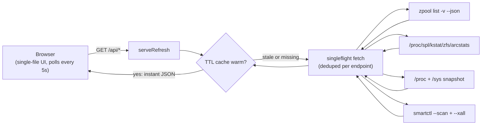

<div align="center">

# ⚡ zDash

**A general system dashboard with a ZFS superpower — that isn't there until you look at it.**

OS, kernel, CPU, memory, network and drives on any host — plus the deep ZFS insight: pool health, vdev topology, per-drive SMART, and ARC cache analytics that show **how well your ZFS is actually working**. Deployed as a **socket-activated systemd service**: zero CPU, zero RAM and zero subprocesses while nobody is watching, **under 10 MB** while you are.

<p>
  <a href="https://github.com/paepckehh/zdash/actions/workflows/golang.yml"></a>
  <a href="https://github.com/paepckehh/zdash/releases"></a>
  <a href="LICENSE"></a>
</p>
<p>
  
  
  
  
  
</p>

<p>
  <a href="#-what-is-zdash"><b>What is zDash?</b></a> ·
  <a href="#-quick-start"><b>Quick Start</b></a> ·
  <a href="#-the-zero-cost-contract"><b>The Zero-Cost Contract</b></a> ·
  <a href="#-screenshots"><b>Screenshots</b></a> ·
  <a href="#-api"><b>API</b></a> ·
  <a href="#-architecture--flow"><b>Architecture</b></a> ·
  <a href="#-deployment-nixos--systemd"><b>Deployment</b></a> ·
  <a href="#-contributing"><b>Contributing</b></a>
</p>

---

</div>

## 🎯 What is zDash?

**1. 🖥️ A general system dashboard.** OS and codename, kernel, SMBIOS vendor/product/version, CPU model, cores and clocks, memory and swap, load averages, uptime, locale, default-route interface and IPv4, process count — a fastfetch-style host overview, always one tab away. Works on any Linux host; FreeBSD and macOS hosts get the pool and SMART views too.

**2. 💾 ZFS-aware — the unique bit.** Most dashboards show you a filesystem; zDash shows you *how well ZFS is working*:

- **Pools** — health, capacity, fragmentation and the full recursive vdev/disk topology, straight from `zpool list -v --json`.
- **Drives** — per-drive SMART tabs (temperatures, wear, power-on hours, ATA/NVMe-specific attributes) probed in parallel, one 12 s budget per device.
- **ARC cache** — the part that decides your real storage performance: hit ratio with a live hit/miss stream and history sparkline, MRU/MFU breakdown, demand vs prefetch, L2ARC stats, read from the ZFS kstat directly.

**3. 😴 Resource-aware — the coolest bit.** zDash is the dashboard you can install on *every machine you own* without a second thought:

- **Socket-activated by systemd** — the binary only exists while someone is actually looking at the dashboard. No connection, no process.
- **Zero passive cost** — no polling daemons, no cron scrapes, no resident agent: 0 CPU, 0 RAM, 0 subprocesses while idle.
- **Under 10 MB while you watch** — measured 9.3 MB RSS under active traffic (the shipped NixOS modules pin `GOMEMLIMIT=8MiB` to make that the default).
- **Minimal CPU while you watch** — one `zpool` run per ~5 s and one `smartctl` sweep per minute, *shared by every open tab*, served from a pre-encoded TTL cache.
- **Featherweight client** — a single ~128 KB page, no framework, no build step, no `node_modules`; a few KB of JSON every 5 s.

<div align="center">

## 📸 Screenshots

| ☀️ Light Mode | 🌙 Dark Mode |
|:---:|:---:|
|  |  |

</div>

---

## 🚀 Quick Start

> **Prerequisites:** Go 1.27+ and a working `zpool` binary on a ZFS host (Linux, FreeBSD, macOS).

**Try it right now** — no clone, no build, no install:

```bash
go run paepcke.de/zdash/cmd/zdash@latest
xdg-open http://localhost:8080
```

**Install it permanently:**

```bash
go install paepcke.de/zdash/cmd/zdash@latest
```

**Or grab a prebuilt static binary** — `.deb`, `.rpm`, and tarballs for linux/freebsd/darwin on amd64/arm64 (all `CGO_ENABLED=0`, statically linked) from the [Releases](https://github.com/paepckehh/zdash/releases) page.

---

## 😴 The Zero-Cost Contract

zDash was designed around one question: *what should a dashboard cost when nobody is looking?* The answer: **nothing** — not "a little", not "one idle thread", nothing. With the socket-activated deployment the process literally does not exist between visits:



### Measured, not promised

| State | CPU | RAM | `zpool` / `smartctl` runs |
|---|---|---|---|
| Nobody looking (socket-activated module) | **0** — process doesn't exist | **0 MB** | **0** |
| Nobody looking (plain module, deep sleep) | ~0 (one parked thread) | ~7 MB boot, ~9 MB parked | **0** |
| You are looking | a few ms per refresh cycle | **9.3 MB** (measured, `GOMEMLIMIT=8MiB`) | 1 `zpool` / ~5 s, 1 `smartctl` sweep / 60 s |

All open tabs share the same TTL cache, so ten dashboards watching one host still cost one `zpool` run every ~5 s. The moment the last tab closes, the refresher stops, the cache drops, the GC switches off, the heap is handed back to the OS, and all but one OS thread park. A late fetch still in flight can never smuggle stale bytes into the next session (session-generation guard on every cache store).

<details>
<summary><b>🛠️ What "deep sleep" actually does under the hood</b></summary>

- `debug.SetGCPercent(-1)` + `debug.FreeOSMemory()` — the GC is switched off and the heap is returned to the OS.
- `runtime.GOMAXPROCS(1)` — all but one OS thread are parked.
- The background refresher stops and its cache is dropped; pages go back to the OS.
- Only the listener epoll stays armed — the first new connection wakes the process instantly, restoring `GOMAXPROCS` and the GC (`GOGC`-tunable).
- With `EXIT_ON_IDLE=1` the process exits (status 0) at the sleep transition — pair it with a systemd `.socket` unit and idle RAM/CPU are *exactly* zero; systemd restarts the binary on the next connection.

</details>

### 🪶 Featherweight on the client, too

- One **~128 KB** HTML payload per browser (then cached) — the entire UI is a single file: no framework, no build step, no `node_modules`.
- After that, just four small JSON responses every 5 s (a few KB total).
- The UI is mount-once / update-in-place: cards are never rebuilt, so the browser spends its cycles on CSS transitions, not DOM churn.
- Tab hidden? Polling pauses — and the server deep-sleeps ~30 s later. Nothing anywhere burns cycles for an audience of zero.

---

## 🔌 API

All endpoints are `GET`-only and return `application/json` (except `/`, which serves the embedded dashboard). Every response is pre-encoded by the session-scoped refresher, so handlers do nothing but copy cached bytes.

| Method | Path | Description |
|--------|------|-------------|
| `GET` | `/` | Embedded single-file dashboard (`text/html`) |
| `GET` | `/api/zpool` | Pool health, capacity, fragmentation, recursive vdev/disk topology — typed `zpool list -v --json` |
| `GET` | `/api/arc` | ARC hit ratio, sizes, MRU/MFU, demand vs prefetch, L2ARC — from the ZFS kstat |
| `GET` | `/api/sysinfo` | Host snapshot: OS, kernel, SMBIOS, CPU, memory, load, network — from `/proc` + `/sys` |
| `GET` | `/api/smart` | Per-drive SMART health: temperatures, wear, power-on hours, ATA/NVMe attributes — from `smartctl` |

```bash
curl -s http://localhost:8080/api/zpool | jq '.pools | keys'
curl -s http://localhost:8080/api/smart | jq '.devices[] | {name, ok, temp: .details.temperature_current}'
```

> Tabs for capabilities the host lacks (no `smartctl`, no ZFS kernel) are hidden automatically — `/api/smart` reports `smartctl_available`, `/api/sysinfo` reports ZFS presence.

---

## 🏗️ Architecture & Flow



1. **Startup** — `cmd/zdash/main.go` builds an `http.Server` with explicit read/write/idle timeouts, registers Go 1.22 method-aware routes (non-GET gets an automatic 405), wires the `ConnState` session hook, and enters deep sleep. Nothing is scraped at boot.
2. **Session** — the first connection wakes the runtime and starts the refresher (`refresher.go`): a 5 s loop that keeps every endpoint warm on its TTL schedule (zpool/arc/sysinfo 6 s, SMART 60 s). The last closed connection stops the loop and drops the cache.
3. **Requests** — handlers answer from the warmed cache; concurrent refreshes of one endpoint dedupe into a single fetch (singleflight). Fetches survive disconnecting clients (`context.WithoutCancel`); waiters whose client dies fall back to the newest stale snapshot.
4. **Rendering** — the dashboard polls all four API endpoints in parallel every 5 s (paused while the tab is hidden). Cards mount once under stable keys, then only mutate in place — CSS transitions animate donuts, bars and sparklines between polls. The nav pill flips to a red *offline* state if any enabled endpoint fails.
5. **Degradation** — failed subprocesses, unparseable files, and missing `/proc`/`/sys` entries degrade to empty fields or JSON error bodies; the server never crashes.

<details>
<summary><b>🔍 Implementation notes (the fun parts)</b></summary>

- **Zero `innerHTML` rebuilds** — the UI is mount-once / update-in-place; every dynamic string (pool names, SMART model strings, host fields) goes through `escapeHTML` before interpolation.
- **Zero-dependency singleflight & TTL cache** — hand-rolled in ~200 lines instead of importing `golang.org/x/sync`; `go.mod` has zero requires.
- **Deterministic parallel SMART** — one goroutine per discovered device, results land in the device's scan slot, so the report order is stable without a lock.
- **Embedded everything** — the whole UI (including inline single-path brand SVGs from simpleicons.org) ships inside the binary via `embed.FS`, rendered once and cached with `sync.OnceValue`.
- **NixOS resolver seam** — `zpool`/`smartctl` are resolved via a `stat` check for `/run/current-system/sw/bin/…` because NixOS does not put them on the default `$PATH`.

</details>

---

## ⚙️ Configuration

| Environment Variable | Default | Description |
|----------------------|---------|-------------|
| `BIND_ADDR` | `127.0.0.1:8080` | Fallback listen address (used only when no systemd fd is adopted) |
| `SOCKET_ACTIVATION` | `0` | Set `1` to adopt the fd systemd passes via `LISTEN_FDS` (Linux only, opt-in — a stray `LISTEN_FDS` can never hijack fd 3) |
| `EXIT_ON_IDLE` | `0` | Set `1` to `exit(0)` once the last session closes (pair with a systemd `.socket` unit) |

The standard Go runtime knobs work too: the shipped NixOS modules set `GOMEMLIMIT=8MiB` to pin the active footprint under 10 MB, and the wake path honors `GOGC` for the GC target percentage.

```bash
./zdash                                   # defaults: localhost only
BIND_ADDR=0.0.0.0:9090 ./zdash           # custom port, all interfaces
GOMEMLIMIT=8MiB ./zdash                  # keep RSS under 10 MB anywhere
BIND_ADDR=127.0.0.1:8080 go run -race ./cmd/zdash   # with the race detector
```

> ⚠️ **`BIND_ADDR=0.0.0.0:…` exposes the dashboard to your network with no authentication.**
> Always front it with a reverse proxy (Caddy, Nginx, Traefik) that adds auth before binding to a non-loopback address.

---

## 🖥️ Deployment: NixOS + systemd

The repo ships **two alternative, identically hardened NixOS modules** (self-contained, all addresses `127.0.0.1:9091`, fronted by a Caddy vhost `http://zdash` that reverse-proxies to the service, `GOMEMLIMIT=8MiB` pinned). Import exactly **one** of them:

```nix
# configuration.nix
imports = [ ./zdash/systemd.nix ];          # starts at boot, deep-sleeps between sessions
# imports = [ ./zdash/systemd-socket.nix ]; # socket-activated: zero idle cost, exits when idle
```

- **`systemd.nix` (plain)** — wanted by `multi-user.target`, binds `127.0.0.1:9091` itself, deep-sleeps between sessions. Idle CPU ≈ 0.
- **`systemd-socket.nix` (socket-activated)** — `systemd.sockets.zdash` (wanted by `sockets.target`) holds the socket; the service is not started at boot at all. The first dashboard connection activates it, the binary adopts the passed fd (`SOCKET_ACTIVATION=1`) and exits (status 0) once the last session closes (`EXIT_ON_IDLE=1`). `StartLimitIntervalSec = 0` keeps the on-demand restarts from ever being rate-limited. Idle RAM/CPU: exactly zero.

<details>
<summary><b>🛡️ Unit hardening highlights</b></summary>

- `ProtectSystem=strict`, `ProtectHome`, `PrivateTmp`, `NoNewPrivileges`, `LockPersonality`, `MemoryDenyWriteExecute`, `RestrictNamespaces`
- `SystemCallFilter=@system-service`, `RestrictAddressFamilies` limited to inet/inet6/unix
- `SocketBindDeny=any` with only `SocketBindAllow=tcp:9091`, `IPAddressDeny=any` with loopback allowed (the Caddy reverse proxy lives on the same host)
- Resource caps: `MemoryMax=128M`, `TasksMax=32` (main process plus parallel smartctl children), and `Nice=10` / `CPUWeight=10` / `IOWeight=10` — a dashboard must never compete with the storage stack it monitors
- Deliberately **not** restricted: capability bounding set, `@privileged`/`@resources` syscall groups, `PrivateDevices`, `ProcSubset` — `zpool`/`smartctl` need raw disks, `/dev/zfs`, and `/proc/spl` kstats

</details>

---

## 🛠️ Build from Source

```bash
git clone https://github.com/paepckehh/zdash.git
cd zdash

# the easy way (wraps go build + version ldflags)
make build

# ...or build directly
go build -C cmd/zdash -o zdash \
  -ldflags="-X main.version=$(git describe --tags --abbrev=0 2>/dev/null || echo 'dev')"

./zdash
```

**Reproduce the full release pipeline locally** — [goreleaser](https://goreleaser.com) (v2) cross-compiles every supported target (linux/freebsd/darwin × amd64/arm64, all `CGO_ENABLED=0`, `-trimpath -s -w`, version stamped into binary and dashboard), packs wrapped tarballs plus `.deb`/`.rpm` packages with docs, and writes `checksums.txt`:

```bash
make release-snapshot   # full dry run: test, build, package, checksums — publishes nothing
make release-check      # validate .goreleaser.yml only
```

Releases are cut automatically by the [Release workflow](https://github.com/paepckehh/zdash/actions/workflows/release.yml) whenever a `v*` tag is pushed.

---

<details>
<summary><b>❓ FAQ</b></summary>

- **The Pools tab shows a 500 error** — the process needs read access to `/dev/zfs` (typically root, or membership in the `zfs`/`disk` group). The error body includes a permissions hint.
- **No SMART tabs** — `smartctl` is missing or not permitted for this user; check `smartctl_available` in `/api/smart`. The endpoint still returns `200` so the UI can hide the tabs gracefully.
- **Running on a host without ZFS** — the server responds `200` everywhere; the dashboard simply hides the Pools/ARC tabs and keeps showing the system overview.
- **Windows** — the library compiles, but there is no `zpool` on Windows; treat it as a build-matrix curiosity, not a target.
- **Why does my hidden browser tab re-wake the server?** — the server drops dormant keep-alive sockets after its 30 s idle timeout and deep-sleeps; the tab's next poll on becoming visible reconnects instantly and wakes it.

</details>

<details>
<summary><b>🗺️ Roadmap (ideas, not promises)</b></summary>

- Prometheus `/metrics` endpoint
- Persistent history across restarts (long-horizon sparklines)
- Pool health-change notifications
- Multi-host aggregation view

</details>

<details>
<summary><b>⭐ Star History</b></summary>

[](https://star-history.com/#paepckehh/zdash&Date)

</details>

---

## 🤝 Contributing

Contributions are welcome! Please:

1. Fork the repo and create a feature branch.
2. Run `make check` (gofmt + vet) before pushing.
3. Add or update tests in the matching `*_test.go` file using the canned fixtures in `testdata/`.
4. Open a pull request with a clear description of **what** and **why**.

> 🤖 **AI Policy** — Go code in this repo is **human-made and human-reviewed**. HTML, the README, and parsers are AI-assisted and labelled as such. Keep Go changes minimal and idiomatic.

---

## 🙏 Acknowledgements

- Distro/host logos: single-path SVGs from [simpleicons.org](https://simpleicons.org), embedded inline so the dashboard stays fully offline-capable (Tux is the fallback).
- ZFS, OpenZFS, and the `zpool --json`/kstat authors, for making all of this data so pleasant to consume.

## 📄 License

Distributed under the **MIT License**. See [`LICENSE`](LICENSE) for details.

---

<div align="center">

**Built with ❤️ using idiomatic Go, embedded assets, and modern web standards — no frameworks, no build step, no node_modules.**

[What is zDash?](#-what-is-zdash) · [Quick Start](#-quick-start) · [The Zero-Cost Contract](#-the-zero-cost-contract) · [API](#-api) · [Architecture](#-architecture--flow) · [Deployment](#-deployment-nixos--systemd) · [Contributing](#-contributing)

</div>
